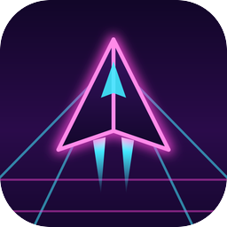

  

<h1 align="center">Antigrav</h1>

<em>Course antigravité néon, pour Android et Linux.</em>

Antigrav est un jeu de course à plus de 1 000 km/h où chaque piste est générée à partir d'un morceau de musique : virages, relief, plaques de boost et obstacles suivent le tempo et l'intensité du morceau. On choisit parmi quatre vaisseaux, on gère une jauge d'énergie qui alimente le boost, le missile et le bouclier, et on court contre sept IA au plus ou contre d'autres joueurs en réseau local.

Le moteur est écrit pour ce jeu, en C++20 sur Vulkan 1.1 et SDL3.

## Installer

Chaque [release](https://github.com/Bornholm/antigrav/releases) contient un APK pour Android 13 ou plus récent, en ARM 64 bits, et une archive `.tar.gz` pour Linux x86_64. Il faut un GPU compatible Vulkan 1.1.

Sur Linux, extraire l'archive et lancer `./antigrav`.

## Documentation

- [Jouer](docs/jouer.md) : commandes, éléments de piste, multijoueur
- [Compiler](docs/compiler.md) : Linux et Android
- [Options de la ligne de commande](docs/options.md)
- [Développer](docs/developper.md) : tests, captures, validation Vulkan, organisation du code
- [Publier](docs/publier.md) : intégration continue, releases, clé de signature

## Licence

Le code est publié sous licence [GNU GPL version 3](LICENSE). La police Orbitron est sous licence [OFL](assets/fonts/OFL.md). La musique a été générée avec le modèle Lyria de Google.
