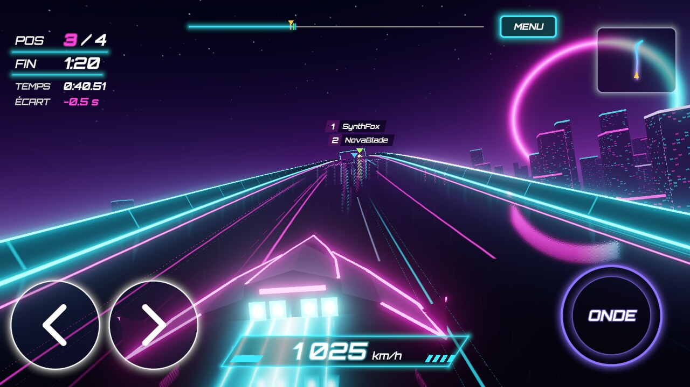

<p align="center">
  
</p>

<h1 align="center">Soundwave</h1>



Soundwave est un jeu de course où chaque piste naît d'un morceau de musique. Vous choisissez un titre, le vôtre ou l'un de ceux livrés, et le jeu en tire la piste : elle accélère quand le morceau s'emballe, grimpe avant un drop et plonge dessus, se resserre et vrille quand il cogne. Le décor bat avec les fréquences et la piste change de couleur avec l'intensité.

La course dure le temps du morceau. On pilote à plus de 1 000 km/h, on ramasse des bonus pour attaquer ou se protéger, et on court contre sept IA au plus ou contre d'autres joueurs en Wi-Fi local. En multijoueur, l'hôte choisit le morceau et le jeu l'envoie aux autres.

Pour Android et Linux. Le moteur est écrit pour ce jeu, en C++20 sur Vulkan 1.1 et SDL3.

## Installer

Chaque [release](https://github.com/Bornholm/soundwave/releases) contient un APK pour Android 13 ou plus récent, en ARM 64 bits, et une archive `.tar.gz` pour Linux x86_64. Il faut un GPU compatible Vulkan 1.1.

Sur Linux, extraire l'archive et lancer `./soundwave`. Pour courir directement sur un fichier :

```sh
./soundwave --song morceau.mp3
```

Les formats lus sont le MP3, l'Ogg Vorbis, le FLAC et le WAV.

## Documentation

- [Jouer](docs/jouer.md) : commandes, bonus, ce que la musique change à la piste, multijoueur
- [Compiler](docs/compiler.md) : Linux et Android
- [Options de la ligne de commande](docs/options.md)
- [Développer](docs/developper.md) : tests, analyse d'un morceau, captures, organisation du code
- [Publier](docs/publier.md) : intégration continue, releases, clé de signature, Play Store
- [Politique de confidentialité](docs/confidentialite.md)

## Licence

Le code est publié sous licence [GNU GPL version 3](LICENSE). La police Orbitron est sous licence [OFL](assets/fonts/OFL.md). Les neuf morceaux livrés et le thème ont été générés avec le modèle Lyria de Google.
